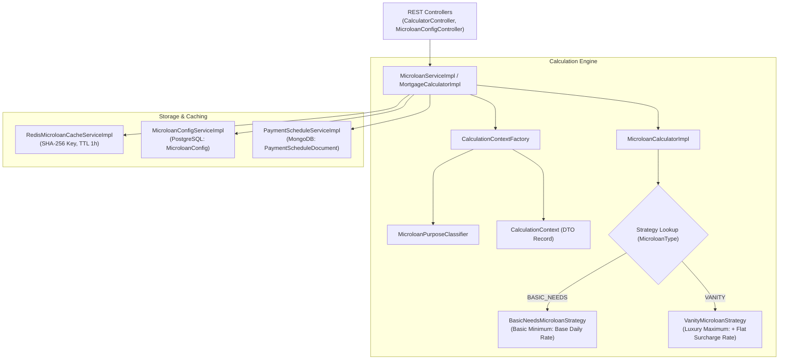

# 🤖 AGENT.md — Backend Context & Architectural Guidelines for MortgageSurprise

> This document is designed for AI agents and software engineers working with the **MortgageSurprise** backend codebase. It provides a comprehensive reference of system architecture, design patterns, domain logic, database schemas, role-based security, and coding standards.

---

## 📌 1. Project Overview & Mission

**MortgageSurprise** is a banking platform engineered for high-precision credit calculations supporting two primary product lines:
1. **Mortgage Loans**: Long-term credit (1–30 years) with annuity and differentiated repayment schemes, early repayments, maternity capital subsidies, and tax deductions.
2. **Microloans (Payday Loans)**: Short-term credit (7–30 days, 1,000 – 100,000 ₽) with daily interest accrual and automated purpose-driven categorization: **"Basic Minimum"** («Базовый минимум») vs. **"Luxury Maximum"** («Роскошный максимум»).

---

## 🏛 2. Architecture & Design Patterns

The backend follows a strict **Layered Architecture** adhering to **SOLID** principles and eliminating the **God Object** anti-pattern through clean separation of DTOs, domain entities, calculation contexts, and strategy implementations.



### 2.1. Strategy Pattern
Package: `com.surprise.mortgagesurprise.calculator.strategy.microloan`
- **Interface**: `MicroloanCalculationStrategy`
  - `CalculationResult calculate(CalculationContext context)`
  - `MicroloanType getSupportedType()`
- **Implementations**:
  - **`BasicNeedsMicroloanStrategy`**: Calculates interest for the **"Basic Minimum"** («Базовый минимум») tier.
    $$\text{Interest} = \text{Amount} \times \left(\frac{\text{BaseDailyRate}}{100}\right) \times \text{TermDays}$$
  - **`VanityMicroloanStrategy`**: Calculates interest for the **"Luxury Maximum"** («Роскошный максимум») tier.
    $$\text{Base Interest} = \text{Amount} \times \left(\frac{\text{BaseDailyRate}}{100}\right) \times \text{TermDays}$$
    $$\text{Fixed Surcharge} = \text{Amount} \times \left(\frac{\text{VanitySurchargeRate}}{100}\right)$$
    $$\text{Total Repayment} = \text{Amount} + \text{Base Interest} + \text{Fixed Surcharge}$$
    *(Note: The surcharge for Luxury Maximum is a **flat, fixed rate** applied to principal once — it is NOT multiplied by days).*
- **Strategy Registry**: `MicroloanCalculatorImpl` dynamically injects all strategies into an immutable `Map<MicroloanType, MicroloanCalculationStrategy>` during application startup.

### 2.2. Factory Pattern
Package: `com.surprise.mortgagesurprise.calculator.factory.CalculationContextFactory`
- Decouples client request payloads (`MicroloanCalculationRequest`) from internal calculation models (`CalculationContext`).
- Obtains bank rate parameters from `MicroloanConfigService`.
- Coordinates automated category determination via `MicroloanPurposeClassifier`.
- Guarantees extensibility: adding credit risk scores, client loyalty discounts, or insurance options modifies only the factory and context without altering calculation strategies.

### 2.3. Semantic Purpose Classifier
Package: `com.surprise.mortgagesurprise.calculator.util.MicroloanPurposeClassifier`
- Evaluates the loan application purpose text:
  - Vanity markers (`iphone`, `apple`, `car`, `tuning`, `club`, `party`, `luxury`, `vip`, `gucci`, `prada`, `gold`, `premium`, `айфон`, `машин`, `авто`, `тюнинг`, `вечеринк`, `люкс`, etc.) $\rightarrow$ `MicroloanType.VANITY`.
  - Essential markers / default $\rightarrow$ `MicroloanType.BASIC_NEEDS`.

---

## 🗄 3. Persistence & Caching Infrastructure

### 3.1. PostgreSQL 17 (Relational Data, Flyway Migrations)
- `users`, `roles`, `user_roles`: User accounts and RBAC permissions.
- `bank_offers`: Commercial mortgage programs.
- `user_scenarios`: Saved user mortgage calculations.
- `microloan_config` (Flyway Migration `V5__add_microloan_config.sql`):
  ```sql
  CREATE TABLE microloan_config (
      id BIGSERIAL PRIMARY KEY,
      base_daily_rate NUMERIC(6, 4) NOT NULL DEFAULT 0.8000,
      vanity_surcharge_rate NUMERIC(6, 4) NOT NULL DEFAULT 5.0000,
      min_amount NUMERIC(12, 2) NOT NULL DEFAULT 1000.00,
      max_amount NUMERIC(12, 2) NOT NULL DEFAULT 100000.00,
      min_term_days INT NOT NULL DEFAULT 7,
      max_term_days INT NOT NULL DEFAULT 30,
      updated_at TIMESTAMP WITH TIME ZONE DEFAULT CURRENT_TIMESTAMP
  );
  ```

### 3.2. MongoDB 7.0 (High-Volume Documents & Audit Logs)
- `payment_schedules` (`PaymentScheduleDocument`): Detailed schedules containing date, principal breakdown, interest breakdown, and remaining balance.
- `calculation_history` (`CalculationHistoryDocument`): Append-only audit log tracking calculation requests, client IP addresses, and timing.
- `user_audit_logs` (`UserActionAuditDocument`): Targeted business audit collection recording actions exclusively for authenticated non-admin users (`ROLE_USER`):
  - `MORTGAGE_CALCULATION`: Loan calculations, including applied bank tariff metadata.
  - `MICROLOAN_CALCULATION`: Microloan simulations by authenticated borrowers.
  - `MICROLOAN_APPLICATION`: Formal online application submissions (`POST /api/v1/calculator/microloan/apply`).
  - `BANK_OFFER_SELECTED`: Bank tariff choices made by users on the offers page (`POST /api/v1/audit/bank-offer-selected`).
  - *Note: Guest visitors and Administrators (`ROLE_ADMIN`) are strictly excluded from `user_audit_logs`.*

### 3.3. Redis 7 (Caching & Rate Limiting)
- **Microloan Cache**: `RedisMicroloanCacheServiceImpl` (prefix `microloan:cache:`).
  - Key generated by `CalculationCacheKeyGenerator.generateKey(request, baseRate, surchargeRate)`.
  - SHA-256 hash incorporates `amount`, `termDays`, `purpose`, `baseDailyRate`, and `vanitySurchargeRate`.
  - **Zero-Stale Invalidation**: Any administrator update to interest rates in PostgreSQL instantly produces a new SHA-256 hash, invalidating obsolete cache entries without manual key scanning. TTL = 1 hour.
- **Mortgage Calculation Cache**: prefix `calc:`.
- **API Rate Limiter**: `RedisRateLimiterServiceImpl` enforcing sliding/fixed window thresholds per client IP or authenticated username.

### 3.4. RabbitMQ 3.13 (Asynchronous Messaging)
- Topic Exchange: `mortgage.exchange`.
- Routing: Rate change events trigger batch scenario recalculations; user events trigger asynchronous notification emails via Mailpit.

---

## 🔐 4. Role-Based Access Control (RBAC) & Security

Configured in `SecurityConfig.java`, enforced at both filter chain and method/controller levels (`CalculatorController.java`, `ScenarioController.java`).

| Role | Permissions & Boundaries |
|---|---|
| **Anonymous Guest** | May calculate mortgages and microloans (`/api/v1/calculator/**`); may retrieve public interest rates (`GET /api/v1/microloan/config`). Cannot save scenarios. |
| **`ROLE_USER`** | Full access to calculate, save scenarios, compare credit products, and export branded PDF schedules. |
| **`ROLE_ADMIN`** | **Strictly a system configurator.** Configures bank offers and microloan rates (`PUT /api/v1/admin/microloan/config`). **Forbidden** from performing calculations or viewing user scenarios (returns **HTTP 403 Forbidden**). UI removes calculator and scenario links for admins. |

> [!IMPORTANT]
> **Mock Passport Data Isolation:** The microloan application modal on the frontend includes passport and identity fields for realistic banking UX simulation. These fields are strictly mock client-side state and are **never sent over the network** to the backend API.

---

## 📡 5. Key REST API Endpoints

### Microloan & Rate Configuration:
- `GET /api/v1/microloan/config` — Public. Returns active rates (`baseDailyRate`, `vanitySurchargeRate`) and loan limits.
- `PUT /api/v1/admin/microloan/config` — Requires `ROLE_ADMIN`. Updates rates and limits.
- `POST /api/v1/calculator/microloan` — Calculates microloan (permitted for `ROLE_USER` and guests; blocked for `ROLE_ADMIN` with 403).
  - Request:
    ```json
    {
      "amount": 10000,
      "termDays": 10,
      "purpose": "New iPhone purchase"
    }
    ```
  - Response:
    ```json
    {
      "amount": 10000.00,
      "termDays": 10,
      "microloanType": "VANITY",
      "baseDailyRate": 0.8000,
      "vanitySurchargeRate": 5.0000,
      "vanitySurchargeAmount": 500.00,
      "totalInterest": 1300.00,
      "totalRepayment": 11300.00,
      "dailyPayment": 1130.00,
      "scheduleId": "673891..."
    }
    ```

### Mortgage Calculations & Early Repayments:
- `POST /api/v1/calculator/calculate` — Calculates mortgage (annuity or differentiated). Supports early repayments with `EarlyRepaymentType` (`ONE_TIME`, `RECURRING`, and `MONTHLY` mapped via `@JsonCreator`). When called by authenticated non-admin users, logs `MORTGAGE_CALCULATION` to MongoDB.
- `POST /api/v1/calculator/compare` — Compares two or more mortgage scenarios.
- `GET /api/v1/calculator/schedule/{scheduleId}/pdf` — Downloads PDF payment schedule.

### User Action Auditing & Online Applications:
- `POST /api/v1/calculator/microloan/apply` — Submits microloan application, generating application ID (e.g. `MS-xxxxx`) and recording `MICROLOAN_APPLICATION` audit log in MongoDB.
- `POST /api/v1/audit/bank-offer-selected` — Audits bank tariff selections (`BANK_OFFER_SELECTED`) when an authenticated user clicks "Оформить" / "Рассчитать".
- `GET /api/v1/admin/audit/logs` — Administrator endpoint (`ROLE_ADMIN`) to query, inspect, and filter MongoDB user audit trails.

### User Scenarios (`ROLE_USER` only):
- `GET /api/v1/scenarios` — Lists saved scenarios for authenticated user.
- `POST /api/v1/scenarios` — Persists a calculated scenario.
- `DELETE /api/v1/scenarios/{id}` — Deletes a scenario.

---

## 📏 6. Financial Precision & Coding Standards

1. **Strictly No `double` or `float`**: All monetary values, rates, and schedule breakdowns must use `java.math.BigDecimal`.
2. **Rounding Rule**: `RoundingMode.HALF_UP` (standard banking rounding).
   - Currency totals: `SCALE = 2` (rubles and kopecks).
   - Interest rates and ratios: `SCALE = 4..8` to prevent intermediate truncation errors.
3. **Immutability**: DTOs and value carriers should be defined as Java `record`s whenever possible.
4. **Clean Domain Separation**:
   - Web DTOs (`dto/...`) must never leak JPA or MongoDB annotations.
   - JPA Entities (`model/entity/...`) and Mongo Documents (`model/document/...`) remain isolated in separate repositories.
5. **Extensibility**: Never overload existing strategy classes. New loan variants must implement `MicroloanCalculationStrategy` and register their unique `MicroloanType`.

---

## 🚀 7. Build, Testing & Deployment

### Complete Stack Startup (Docker Compose):
```bash
docker compose up -d --build
```

### Backend Unit & Integration Tests:
```bash
cd mortgagesurprise
.\gradlew.bat test
```

### Standalone Spring Boot JAR Build:
```bash
cd mortgagesurprise
.\gradlew.bat bootJar -x test
```