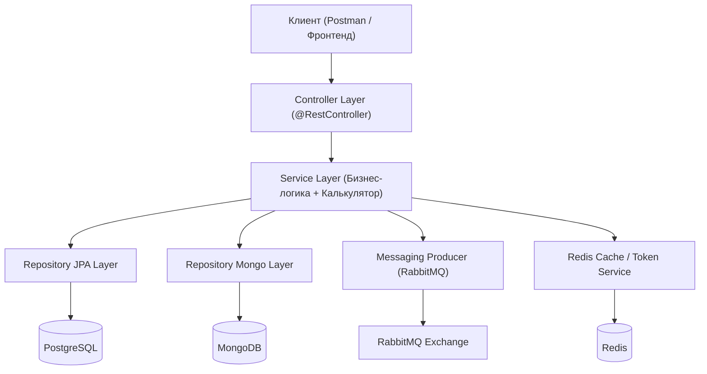

# MortgageSurprise — Ипотечный калькулятор и сервис управления сценариями

Архитектурный каркас (boilerplate) и расчетное ядро для сервиса ипотечных расчетов, сравнения сценариев и банковских предложений.

## Стек технологий
- **Язык**: Java 25
- **Фреймворк**: Spring Boot 4.1.2 (Spring Security, Spring Data JPA, Spring Data MongoDB, Spring AMQP)
- **Базы данных**:
  - **PostgreSQL**: Пользователи, роли, банковские предложения, сохраненные сценарии (миграции через **Flyway**).
  - **MongoDB**: Рассчитанные графики платежей (`payment_schedules`), история расчетов (`calculation_history`).
- **Инфраструктура**:
  - **Redis**: Кэш расчетов и банковских предложений, хранилище refresh-токенов, rate limiter.
  - **RabbitMQ**: Очереди событий «ставка изменилась» (`mortgage.rate.changed.queue`) и email-уведомлений (`mortgage.email.notification.queue`).
  - **Docker Compose**: Развертывание всех сервисов одной командой.

---

## Архитектура проекта (Классическая слоистая / Layered Architecture)

Проект организован по канонической слоистой архитектуре (**Package-by-Layer**):

```
com.surprise.mortgagesurprise
├── config/              # Конфигурационные бины (Security, Redis, RabbitMQ)
├── controller/          # REST контроллеры (Web-слой)
├── dto/                 # Data Transfer Objects (auth, calculator, bank, scenario)
├── exception/           # Глобальная обработка ошибок и кастомные исключения
├── messaging/           # RabbitMQ события, продюсеры и консьюмеры
├── model/
│   ├── entity/          # JPA сущности PostgreSQL (User, Role, BankOffer, CalculationScenario)
│   ├── document/        # Документы MongoDB (PaymentScheduleDocument, CalculationHistoryDocument)
│   └── enums/           # Перечисления (PaymentType, RepaymentStrategy, EarlyRepaymentType)
├── repository/
│   ├── jpa/             # Spring Data JPA репозитории (PostgreSQL)
│   └── mongo/           # Spring Data MongoDB репозитории
├── security/            # JWT фильтр, провайдер токенов и CustomUserDetails
└── service/             # Интерфейсы сервисов
    ├── impl/            # Реализации сервисов (*ServiceImpl)
    ├── AuthService.java
    ├── CalculatorService.java
    ├── MortgageCalculator.java
    ├── BankOfferService.java
    ├── ScenarioService.java
    ├── CustomUserDetailsService.java
    ├── RefreshTokenService.java
    ├── RateLimiterRedisService.java
    └── CalculationCacheService.java
```



---

## Что уже реализовано

1. **Расчетное ядро (`service/MortgageCalculatorImpl`)**:
   - Аннуитетные и дифференцированные платежи.
   - Досрочные погашения: разовые (`ONE_TIME`) и регулярные (`RECURRING`).
   - Стратегии: уменьшение срока (`REDUCE_TERM`) и уменьшение платежа (`REDUCE_PAYMENT`).
   - Деньги строго в `BigDecimal`, округление `RoundingMode.HALF_UP`.
   - 100% покрытие юнит-тестами банковских эталонов (`MortgageCalculatorTest`).
2. **PostgreSQL + Flyway**:
   - Миграция `V1__init_schema.sql` (таблицы `users`, `bank_offers`, `calculation_scenarios`, внешние ключи и индексы).
3. **MongoDB**:
   - Коллекции `payment_schedules` (помесячные графики платежей) и `calculation_history`.
4. **Контроллеры (Web-слой)**:
   - `CalculatorController`: публичный расчет (`POST /api/v1/calculator/calculate`) и получение графика (`GET /api/v1/calculator/schedules/{id}`).
   - `BankOfferAdminController` & `BankOfferPublicController`: CRUD банковских предложений (при изменении ставки публикуется `RateChangedEvent`).
   - `ScenarioController`: сохранение и сравнение 2–3 сценариев бок о бок.
   - `AuthController`: регистрация, логин, refresh токенов, logout.
5. **Безопасность (Security)**:
   - `SecurityConfig`: stateless-сессии, калькулятор и каталог банков открыты, админка защищена `hasRole('ADMIN')`.
   - `JwtTokenProvider` + `JwtAuthenticationFilter`.
6. **Инфраструктура**:
   - `docker-compose.yml`: PostgreSQL 17, MongoDB 7, Redis 7, RabbitMQ 3 Management, App.
   - `Dockerfile`: Java 25 multi-stage сборка.

---

## Запуск проекта

### Вся инфраструктура и приложение в Docker
```bash
docker compose up -d --build
```
Доступные порты:
- Spring Boot API: `http://localhost:8080`
- RabbitMQ Management UI: `http://localhost:15672` (логин/пароль: `guest` / `guest`)
- PostgreSQL: `localhost:5432`
- MongoDB: `localhost:27017`
- Redis: `localhost:6379`

### Локальный запуск
```bash
docker compose up -d postgres mongodb redis rabbitmq
cd mortgagesurprise
./gradlew bootRun
```

---

## План работ для напарников (Todo list)

1. **Redis**:
   - `RedisCalculationCacheService`: включить кэш расчетов по SHA-256 хэшу параметров в `CalculatorService`.
   - `RedisRateLimiterService`: настроить фильтр/интерцептор ограничения частоты запросов к `/api/v1/calculator/calculate`.
   - `RedisRefreshTokenService`: управление валидностью и отзывом токенов в Redis.
2. **RabbitMQ**:
   - `RateChangedConsumer`: найти зависимые сценарии пользователей в PostgreSQL, пересчитать их по новой ставке через `MortgageCalculator` и обновить записи в Postgres и Mongo.
   - `EmailNotificationConsumer`: отправка email подтверждения почты (JavaMailSender / заглушка).
3. **OAuth2**:
   - Настроить Google/GitHub авторизацию в `SecurityConfig` (`oauth2Login()`).
