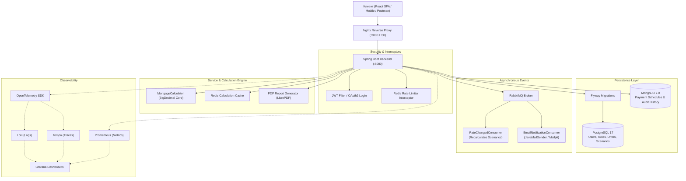
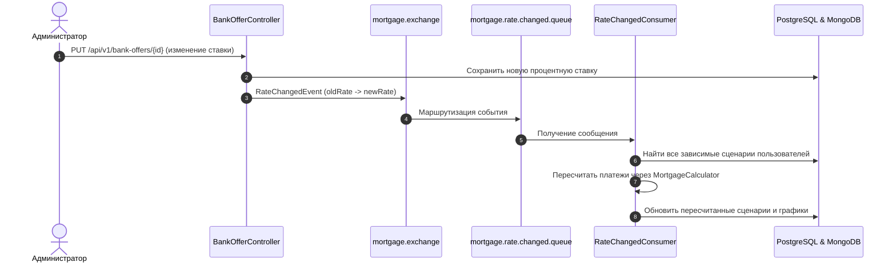

# 🏦 MortgageSurprise — Экосистема ипотечных расчетов и аналитики

<p align="center">
  
  
  
  
  
  
  
  
  
  
</p>

Полнофункциональная production-ready платформа для высокоточного расчета ипотечных кредитов, сравнения финансовых сценариев, каталогизации банковских предложений и мониторинга процентных ставок.

---

## 📑 Содержание
1. [Архитектура и концепция](#-архитектура-и-концепция)
2. [Технологический стек](#-технологический-стек)
3. [Ключевые возможности](#-ключевые-возможности)
4. [Структура проекта](#-структура-проекта)
5. [Быстрый старт через Docker Compose](#-быстрый-старт-через-docker-compose)
6. [Учетные записи по умолчанию](#-учетные-записи-по-умолчанию)
7. [Порты и сервисы](#-порты-и-сервисы)
8. [API Спецификация](#-api-спецификация)
9. [Асинхронные события и очереди (RabbitMQ)](#-асинхронные-события-и-очереди-rabbitmq)
10. [Observability & Мониторинг](#-observability--мониторинг)
11. [Локальная разработка и тестирование](#-локальная-разработка-и-тестирование)

---

## 🏛 Архитектура и концепция

Система построена на принципах **многоуровневой слоистой архитектуры (Package-by-Layer)**, совмещая реляционную модель (PostgreSQL) для критически важных связных данных с документоориентированной моделью (MongoDB) для тяжелых графиков платежей и аудита расчетов.



---

## 🛠 Технологический стек

| Область | Технологии |
|---|---|
| **Язык & Core** | Java 25, Gradle 9.8 (Kotlin DSL) |
| **Backend Framework** | Spring Boot 3.4.5, Spring Security 6, Spring Data JPA, Spring Data MongoDB, Spring AMQP |
| **Frontend** | React 19, TypeScript 5.7, Vite 6, Tailwind CSS 4, Lucide Icons, Axios |
| **Базы данных** | **PostgreSQL 17** (ACID транзакции, Flyway миграции), **MongoDB 7.0** (графики платежей, история) |
| **Кэш & Rate Limiting** | **Redis 7** (SHA-256 кэширование расчетов, refresh-токены, Sliding/Fixed Window лимитер) |
| **Брокер сообщений** | **RabbitMQ 3.13** (Exchange `mortgage.exchange`, DLQ, повторные попытки) |
| **Почтовый сервер** | **Mailpit** (SMTP сервер для тестирования HTML-писем и волшебных ссылок) |
| **Observability** | **OpenTelemetry**, **Prometheus**, **Grafana 11.3**, **Grafana Tempo 2.6**, **Grafana Loki 3.1** |
| **Отчетность** | **LibrePDF / OpenPDF** (генерация брендированных PDF-выписок графика платежей) |
| **Контейнеризация** | Docker, Docker Compose (Multi-stage build, rootless Alpine контейнеры) |

---

## ✨ Ключевые возможности

### 1. Высокоточное расчетное ядро (`MortgageCalculator`)
- **Типы платежей**: Аннуитетные (равными долями) и дифференцированные (убывающие).
- **Досрочные погашения**:
  - Разовые (`ONE_TIME`) и регулярные (`RECURRING`, ежемесячные).
  - Гибкие стратегии: **сокращение срока** (`REDUCE_TERM`) или **сокращение платежа** (`REDUCE_PAYMENT`).
- **Финансовая строгость**: все расчеты ведутся строго в `BigDecimal` с округлением `RoundingMode.HALF_UP` по банковским стандартам.
- **Мультивалютность**: нативная поддержка **RUB (₽)**, **USD ($)**, **EUR (€)** и **BYN (Br)** на уровне расчетов, истории и каталога банков.

### 2. Безопасность и управление доступом
- **JWT Аутентификация**: Access Token (15 минут) + Refresh Token в Redis с механизмом отзыва при выходе.
- **Вход без пароля**: Magic Link на почту пользователя с одноразовым подтверждением.
- **OAuth 2.0**: Вход в один клик через **Google** и **GitHub** с автоматическим созданием аккаунта и безопасным редиректом.
- **Ролевая модель**:
  - `ROLE_USER`: расчеты, сохранение личных сценариев, сравнение предложений, выгрузка PDF.
  - `ROLE_ADMIN`: полное управление банковскими предложениями (CRUD) в каталоге.

### 3. Защита от перегрузок и кэширование
- **Redis Rate Limiter**: `RateLimitInterceptor` защищает эндпоинт `/api/v1/calculator/calculate`, возвращая при превышении лимита HTTP `429 Too Many Requests` со структурированным JSON и заголовками `X-RateLimit-*`.
- **Хэш-кэш расчетов**: одинаковые параметры расчета идентифицируются по SHA-256 хэшу и отдаются мгновенно из Redis.

### 4. Интерактивный веб-интерфейс (React + TS)
- Динамический калькулятор с ползунками, выбором валюты и мгновенной визуализацией переплаты.
- Интерактивный график платежей с фильтрацией, пагинацией и кнопкой **«Скачать PDF»**.
- Каталог предложений банков с возможностью расчета в один клик.
- Панель администратора: создание, изменение параметров (ставки, валюты, лимитов) и удаление банков прямо в UI.
- Менеджер сценариев: сохранение и сравнение до 3 сценариев бок о бок.

---

## 📂 Структура проекта

```
MortgageSurprise/
├── docker-compose.yml              # Оркестрация 11 контейнеров экосистемы
├── loki.yaml                       # Конфигурация Grafana Loki
├── tempo.yaml                      # Конфигурация Grafana Tempo
├── grafana/                        # Провижининг дашбордов и источников данных Grafana
├── frontend/                       # Клиентское приложение (React 19 + TypeScript + Vite)
│   ├── src/
│   │   ├── api/                    # Axios-клиент, перехватчики токенов, API-сервисы
│   │   ├── components/             # Модалки авторизации, калькулятор, графики, Navbar
│   │   ├── context/                # AuthContext (JWT, сессии, роли)
│   │   ├── pages/                  # Страницы: Калькулятор, Банки, Сценарии, Callback
│   │   └── types/                  # TypeScript интерфейсы DTO
│   ├── nginx.conf                  # Nginx Reverse Proxy конфигурация для продакшна
│   └── Dockerfile                  # Multi-stage сборка Node 22 -> Nginx Alpine
└── mortgagesurprise/               # Spring Boot приложение (Java 25)
    ├── src/main/java/com/surprise/mortgagesurprise/
    │   ├── config/                 # Security, Redis, RabbitMQ, OpenTelemetry
    │   ├── controller/             # REST API: Auth, Calculator, BankOffers, Scenarios
    │   ├── dto/                    # Запросы и ответы API
    │   ├── exception/              # GlobalExceptionHandler, бизнес-исключения
    │   ├── interceptor/            # RedisRateLimiterInterceptor
    │   ├── messaging/              # RabbitMQ Producer, Consumer, Events
    │   ├── model/                  # JPA Entity (PostgreSQL), Documents (MongoDB), Enums
    │   ├── repository/             # Spring Data JPA & Mongo репозитории
    │   ├── security/               # JwtProvider, JwtFilter, CustomUserDetailsService
    │   └── service/                # Сервисный слой, ядро расчетов, генерация PDF
    ├── src/main/resources/
    │   ├── db/migration/           # Flyway миграции (V1__init, V2.. V4__seed_admin)
    │   ├── application.yaml        # Конфигурация профилей, баз, брокеров, метрик
    │   └── logback-spring.xml      # Конфигурация структурированного логирования
    └── Dockerfile                  # Легковесный Eclipse Temurin JRE 25 Alpine
```

---

## 🚀 Быстрый старт через Docker Compose

### 1. Клонирование репозитория
```bash
git clone https://github.com/Kirill-Krup/MortgageSurprise.git
cd MortgageSurprise
```

### 2. Сборка и запуск всех сервисов
```bash
docker compose up -d --build
```

Все 11 сервисов запустятся автоматически, пройдут healthcheck и будут готовы к работе.

### 3. Проверка статуса контейнеров
```bash
docker compose ps
```

---

## 🔑 Учетные записи по умолчанию

| Роль / Сервис | Email / Логин | Пароль | Назначение |
|---|---|---|---|
| **Администратор системы** | `admin@mortgagesurprise.com` | `admin123` | Полный доступ, CRUD банковских предложений |
| **Тестовый пользователь** | `kiryl.test@example.com` | `password123` | Расчет и сохранение персональных сценариев |
| **RabbitMQ Management** | `guest` | `guest` | Мониторинг очередей и сообщений |
| **Grafana** | `admin` | `admin` | Просмотр метрик, трейсов и логов |
| **PostgreSQL** | `postgres` | `postgres` | База данных `mortgagesurprise` |

> [!TIP]
> В окне входа на фронтенде доступна кнопка **«Заполнить»** для мгновенной подстановки учетных данных администратора.

---

## 🌐 Порты и сервисы

| Сервис | Порт | URL / Точка входа | Описание |
|---|---|---|---|
| **Frontend** | `3000`, `80` | [http://localhost:3000](http://localhost:3000) | Веб-интерфейс приложения |
| **Backend REST API** | `8080` | [http://localhost:8080](http://localhost:8080) | Spring Boot REST API |
| **Mailpit Web UI** | `8025` | [http://localhost:8025](http://localhost:8025) | Просмотр отправленных писем (Magic Link, верификация) |
| **Mailpit SMTP** | `1025` | `localhost:1025` | Внутренний SMTP сервер |
| **RabbitMQ Management** | `15672` | [http://localhost:15672](http://localhost:15672) | Панель управления брокером RabbitMQ |
| **RabbitMQ Broker** | `5672` | `localhost:5672` | AMQP протокол |
| **Grafana** | `3001` | [http://localhost:3001](http://localhost:3001) | Дашборды мониторинга |
| **Prometheus** | `9090` | [http://localhost:9090](http://localhost:9090) | Сборщик системных метрик |
| **PostgreSQL** | `5432` | `localhost:5432` | Реляционная СУБД |
| **MongoDB** | `27017` | `localhost:27017` | Документная СУБД |
| **Redis** | `6379` | `localhost:6379` | Кэш и сессии |
| **Grafana Tempo** | `3200`, `4317`, `4318`| `localhost:4318` | Сборник трейсов OTLP |
| **Grafana Loki** | `3100` | `localhost:3100` | Сборник логов OTLP |

---

## 📡 API Спецификация

### Аутентификация (`/api/v1/auth`)
| Метод | Эндпоинт | Доступ | Описание |
|---|---|---|---|
| `POST` | `/api/v1/auth/register` | Public | Регистрация нового пользователя |
| `POST` | `/api/v1/auth/login` | Public | Аутентификация по логину/паролю, возврат JWT |
| `POST` | `/api/v1/auth/refresh` | Public | Обновление пары Access/Refresh токенов |
| `POST` | `/api/v1/auth/logout` | Authenticated | Инвалидация токена в Redis |
| `GET` | `/api/v1/auth/me` | Authenticated | Получение профиля текущего пользователя |
| `POST` | `/api/v1/auth/magic-link` | Public | Запрос волшебной ссылки для входа на email |
| `GET` | `/api/v1/auth/magic-link/verify` | Public | Подтверждение входа по ссылке из письма |
| `POST` | `/api/v1/auth/oauth2/exchange` | Public | Обмен временного OAuth2-кода на JWT |

### Ипотечный калькулятор (`/api/v1/calculator`)
| Метод | Эндпоинт | Доступ | Описание |
|---|---|---|---|
| `POST` | `/api/v1/calculator/calculate` | Public (Rate Limited) | Расчет ипотеки, сохранение графика в MongoDB |
| `GET` | `/api/v1/calculator/schedules/{id}` | Public | Получение сохраненного графика платежей |
| `POST` | `/api/v1/calculator/compare` | Public | Сравнение нескольких расчетов бок о бок |
| `POST` | `/api/v1/calculator/export/pdf` | Authenticated | Генерация брендированного PDF-отчета |

### Банковские предложения (`/api/v1/bank-offers` & `/api/v1/admin/bank-offers`)
| Метод | Эндпоинт | Доступ | Описание |
|---|---|---|---|
| `GET` | `/api/v1/bank-offers` | Public | Список активных предложений банков (`?all=true` для всех) |
| `GET` | `/api/v1/bank-offers/{id}` | Public | Детальная информация о предложении |
| `POST` | `/api/v1/bank-offers` | `ROLE_ADMIN` | Создание нового предложения |
| `PUT` | `/api/v1/bank-offers/{id}` | `ROLE_ADMIN` | Обновление предложения (эмитит `RateChangedEvent`) |
| `DELETE` | `/api/v1/bank-offers/{id}` | `ROLE_ADMIN` | Удаление банковского предложения |

### Сценарии пользователя (`/api/v1/scenarios`)
| Метод | Эндпоинт | Доступ | Описание |
|---|---|---|---|
| `GET` | `/api/v1/scenarios` | Authenticated | Получение всех сохраненных сценариев пользователя |
| `POST` | `/api/v1/scenarios` | Authenticated | Сохранение расчетного сценария в PostgreSQL |
| `GET` | `/api/v1/scenarios/{id}` | Authenticated | Получение сценария по идентификатору |
| `DELETE` | `/api/v1/scenarios/{id}` | Authenticated | Удаление сценария |
| `GET` | `/api/v1/scenarios/compare` | Authenticated | Сравнение выбранных сценариев по `?ids=uuid1,uuid2` |

---

## 📬 Асинхронные события и очереди (RabbitMQ)

Проект использует шину сообщений AMQP для фоновой асинхронной обработки:



1. **`mortgage.rate.changed.queue`**:
   - При обновлении процентной ставки по любому кредитному предложению автоматически создается событие `RateChangedEvent`.
   - `RateChangedConsumer` ищет в PostgreSQL сценарии пользователей, привязанные к этому банку, пересчитывает график через расчетное ядро и обновляет данные в Postgres и MongoDB.
2. **`mortgage.email.notification.queue`**:
   - Асинхронная доставка писем для верификации почты и входа по волшебной ссылке через `EmailNotificationConsumer`.

---

## 📊 Observability & Мониторинг

В проект встроен полный стек сквозного наблюдения (Observability):

- **Distributed Tracing (Трассировка)**: Каждый HTTP-запрос маркируется `traceId` и `spanId` через OpenTelemetry и передается в **Grafana Tempo**.
- **Centralized Logs (Логи)**: Логирование в формате JSON с метаданными трассировки транслируется напрямую в **Grafana Loki**.
- **Metrics (Метрики)**: Spring Boot Actuator собирает метрики JVM, HTTP-запросов и пулов соединений HikariCP и отдает их в **Prometheus** по адресу `/actuator/prometheus`.
- **Dashboards (Дашборды)**: Доступны в **Grafana** ([http://localhost:3001](http://localhost:3001)).

---

## 💻 Локальная разработка и тестирование

### Требования
- JDK 25
- Node.js 22+ & npm
- Docker & Docker Desktop

### 1. Поднятие только инфраструктуры
```bash
docker compose up -d postgres mongodb redis rabbitmq mailpit tempo loki prometheus grafana
```

### 2. Запуск Backend локально
```bash
cd mortgagesurprise
./gradlew bootRun
```

### 3. Запуск Frontend в режиме разработки
```bash
cd frontend
npm install
npm run dev
```
Фронтенд запустится на [http://localhost:5173](http://localhost:5173) с поддержкой Hot Module Replacement (HMR).

### 4. Запуск тестов
```bash
cd mortgagesurprise
./gradlew test
```
Все тесты (юнит-тесты расчетного ядра, интеграционные тесты безопасности, RabbitMQ и Rate Limiter) выполняются автоматически на изолированных контекстах.

---

<p align="center">
  <b>MortgageSurprise</b> — точные расчеты, надежная архитектура и финансовая прозрачность.
</p>
